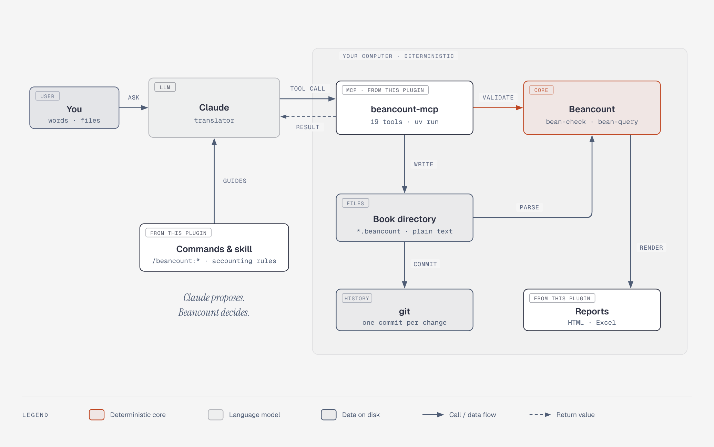

# Beancount plugin for Claude Code

This plugin makes Claude Code a bookkeeper. It uses
[Beancount](https://github.com/beancount/beancount), which is an open-source, command-line
[double-entry bookkeeping system](https://beancount.io/de/blog/2025/09/02/journal-entries-in-beancount).
With Beancount, you record financial transactions in plain text files. The ledger stays on your
computer.

The plugin is a wrapper around Beancount. It does not replace Beancount, and it does not do its
own bookkeeping. It gives Claude access to Beancount through MCP tools.

The plugin has three parts:

- An **MCP server**. It keeps a Beancount ledger (the "book") in a local directory. The book is a
  git repository. Before each change, the server checks the ledger with `bean-check`. The server
  records only a correct change, and it makes a git commit for each change. Thus, you can undo
  each change.
- **Slash commands**. They create the book, import statements and receipts, and make reports.
- A **skill** (`beancount-accounting`). It gives Claude the rules for correct double-entry
  transactions.

## How it works



### Beancount does the bookkeeping, not the LLM

**Beancount and the code of the plugin process all transactions deterministically.** The same
input always gives the same result. The LLM does not do these steps:

- **Validation.** `bean-check` examines each change before the server records it. If a
  transaction does not balance, or if an account is not open, the server rejects the change. The
  book does not change.
- **Calculation.** Balances, totals, currency conversions and reports come from Beancount
  (`bean-query`). The LLM does not calculate a number.
- **Statement import.** The plugin reads CSV, OFX and QFX statements with its own parser. The rows
  do not go through the LLM. Thus, the LLM cannot change an amount or a date.
- **History.** git records each accepted change. You can see each change and undo it.

### The role of the LLM: a translator

Claude is a translator between you and the MCP tools:

1. Claude reads your request, for example "I paid 54.20 EUR for groceries" or a bank statement.
2. Claude changes the request into a call to an MCP tool.
3. Beancount and the plugin do the work and send back a result.
4. Claude changes the result into words for you.

Claude also selects the accounts (for example `Expenses:Food`). For a text description or a
receipt, Claude writes the proposed entry. The plugin tells Claude to show you each proposal
before the server writes it. Beancount then checks the entry. Claude cannot record an entry that Beancount rejects.

The plugin does not send data to a server. The book stays on your computer. Claude sees only the
data that it reads for you, for example a statement summary or a query result.

## Commands

| Command | Function |
|---|---|
| `/beancount:init [name] [currency]` | Creates the local book and a starter chart of accounts. It asks you where to keep the book. |
| `/beancount:location [path\|default]` | Shows the directory of the book, or sets a new directory. |
| `/beancount:ingest <file or text>` | Imports a bank or card statement (CSV, OFX/QFX, PDF), a receipt photo or a text description. The result is a set of correct transactions. |
| `/beancount:report [html\|excel\|both] [as-of] [period-start]` | Makes an HTML report, an Excel workbook or the two. The report has a balance sheet, an income statement and the transactions. |
| `/beancount:status [question]` | Shows the net worth, the balances and the recent changes. It can also answer a question about your money. |
| `/beancount:assess [focus]` | Examines the book. It shows the run rate, the categories, the changes, unusual entries and gaps in the data. |
| `/beancount:undo [commit]` | Reverts a change from the git history. |

## Install the plugin

Before you install the plugin, install uv and git. Refer to [Requirements](#requirements).

The MCP server of the plugin runs on your computer. Thus, the plugin works in these applications:

- The Claude desktop app: Cowork and the **Code** tab. Use this procedure if you are a user.
- Claude Code in a terminal or an IDE. Use this procedure if you are a developer.

The plugin does not work in a chat on claude.ai or in a cloud session. These applications cannot
start a program on your computer.

### Claude desktop app (Cowork and Code)

1. In the sidebar, select **Customize**. Then select **Plugins**.
2. Select **Add**. Then select **Add marketplace**.
3. Type the URL of the repository and confirm:

   ```text
   https://github.com/b0r1sp/beancount-plugin
   ```

4. Select **Discover**. Find the plugin `beancount` and select it.
5. Select **Add** (or **Install**).
6. Start a new Cowork task, or open a local session in the **Code** tab. The plugin loads when
   the task or the session starts.
7. Type this command to create the book:

   ```text
   /beancount:init
   ```

The plugin is saved to your account. Thus, it is also available in Claude Code when you sign in
with the same account.

On the first start, uv downloads Python and the dependencies. This takes approximately 30
seconds.

If the tools are not available:

1. Open the plugin in **Customize** > **Plugins**. Make sure that the plugin is enabled.
2. Make sure that uv is installed. If you installed uv after you started the desktop app, quit
   the desktop app and start it again.
3. Make sure that the computer has a network connection for the first start.

To get a new version of the plugin, open the marketplace in **Customize** > **Plugins** and
select **Check for updates**.

### Claude Code (terminal or IDE)

Type each command separately in Claude Code. Do not paste the commands together. Claude Code
reads a paste of many lines as one slash command, and the install fails.

1. Add the marketplace:

   ```text
   /plugin marketplace add https://github.com/b0r1sp/beancount-plugin.git
   ```

2. Install the plugin:

   ```text
   /plugin install beancount@beancount
   ```

3. Load the plugin into the session:

   ```text
   /reload-plugins
   ```

4. Create the book:

   ```text
   /beancount:init
   ```

Use the full HTTPS URL. Do not use the short form `b0r1sp/beancount-plugin`. The short form can
use SSH, and SSH needs a key.

To install from a local clone, use `/plugin marketplace add ./beancount-plugin`. Then do steps 2
to 4.

On the first start, uv makes a virtual environment in the plugin directory. This takes
approximately 30 seconds. Claude Code asks you to approve the MCP server. Approve it. If the
tools are not available after this, type `/reload-plugins` again.

If the server does not start:

1. Type `/mcp`. Claude Code shows the error from the server.
2. Make sure that uv is on the `PATH`. If you installed uv after you started Claude Code,
   restart Claude Code.
3. Make sure that the computer has a network connection for the first start.

## Requirements

| Tool | Function |
|---|---|
| The Claude desktop app (Cowork or the **Code** tab) or [Claude Code](https://docs.claude.com/en/docs/claude-code) | Runs the plugin. |
| [uv](https://docs.astral.sh/uv/) | Starts the MCP server. On the first start, uv downloads Python 3.11+ and the dependencies. |
| [git](https://git-scm.com/) | Keeps the history of the book. |

### Install uv

On macOS or Linux, use this command:

```bash
curl -LsSf https://astral.sh/uv/install.sh | sh
```

On Windows, use this command in PowerShell:

```powershell
powershell -ExecutionPolicy ByPass -c "irm https://astral.sh/uv/install.ps1 | iex"
```

You can also use `brew install uv`, `winget install --id astral-sh.uv -e` or `pipx install uv`.

### Install git

Usually, git is already on your computer. On Windows, Claude Code usually needs Git for Windows.

| Operating system | Command |
|---|---|
| Windows | `winget install --id Git.Git -e` |
| macOS | `xcode-select --install` (or `brew install git`) |
| Debian / Ubuntu | `sudo apt install git` |

If git is not available, the first change to the book stops. The error message shows the install
command for your operating system. The book does not change.

## Location of your data

| Data | Location |
|---|---|
| The book (a git repository of `.beancount` files) | Default: `~/.beancount/main`. On Windows: `C:\Users\<you>\.beancount\main`. You can select a different directory (see below). |
| Reports | `<book>/reports/`. Git ignores this directory. |
| Statements and import proposals before the import | `<book>/.git/beancount-imports/`. Git does not commit these files. |
| The saved directory of the book | `~/.beancount/config.json` |
| Receipt photos and PDF files | `~/.beancount/receipts/<sha256>`. These files are outside the book. Thus, they do not make the git history large. |

### Use a different directory

You can keep the book in any local directory that you select. For example, use a directory in
your documents, on a second disk or in a folder that you synchronize. The default directory is
only a recommendation.

To select the directory, use one of these procedures:

- When you create the book with `/beancount:init`, give the full path of the directory.
- For a book that already exists, type the command with the full path of the directory:

  ```text
  /beancount:location /Users/ana/Documents/books
  ```

  On Windows, use a path such as `D:\finance\books`.

- You can also ask Claude in your own words, for example "keep my book in
  D:\finance\books".

The plugin saves the directory in `~/.beancount/config.json`. All tools use the new directory
immediately. You do not have to restart the application.

To go back to the default directory, type `/beancount:location default`.

The command does not move the book. To move a book, first move the full directory to the new
location. Include the hidden `.git` directory. Then set the new location.

`/beancount:init` does not overwrite files. If the directory already contains files with the
same names as the files of a book, the command stops and shows the names.

#### Developers: the environment variable

The variable `BEANCOUNT_BOOK` overrides the saved directory. Set it before you start Claude Code.
You can also set it in the `env` block of the plugin file `.mcp.json`.

On macOS or Linux:

```bash
export BEANCOUNT_BOOK=~/finance/books
```

On Windows (the setting applies to new terminals):

```powershell
setx BEANCOUNT_BOOK "D:\finance\books"
```

The plugin uses the first available value in this sequence:

1. The variable `BEANCOUNT_BOOK`.
2. The directory that you saved with `/beancount:location` or `/beancount:init`.
3. The default directory `~/.beancount/main`.

To see the directory that the plugin uses, ask Claude "where is my book?". Claude uses the
`book_location` tool.

The book is a git repository of text files. To make a backup, push the repository to a remote.

## Examine the book in Fava

[Fava](https://beancount.github.io/fava/) is a web interface for Beancount. Fava needs only uv.

On macOS or Linux:

```bash
uvx fava ~/.beancount/main/main.beancount
```

On Windows:

```powershell
uvx fava $env:USERPROFILE\.beancount\main\main.beancount
```

Then open <http://localhost:5000> in a browser. Fava shows the entries that Claude flags with `!`
as pending.

If you change the ledger in Fava, commit the change yourself. In the book directory, type
`git commit -am "<message>"`. The plugin adds to git only the files that it writes.

## MCP tools

The server has these tools:

`book_location`, `set_book_location`, `create_book`, `book_status`, `list_accounts`, `get_ledger`, `open_accounts`,
`add_transactions`, `add_directives`, `propose_transactions`, `commit_proposal`, `run_query`,
`balances`, `assess_book`, `generate_report`, `history`, `revert`, `stage_receipt`,
`propose_receipt_transaction`.

The server also has a `bookkeeping` prompt and a `bookkeeping` resource. They contain the
bookkeeping rules for each MCP client.

### Statement import

1. `propose_transactions` reads a CSV, OFX or QFX statement for one account. It does not change
   the book. It returns a summary with a `proposal_id`. The summary shows the column mapping,
   the counts, the flagged rows and each payee one time.
2. You select an account for each payee.
3. `commit_proposal` writes the proposal with these accounts. The server checks the result and
   makes one commit.

The rows do not go through the model. Thus, the model does not limit the size of a statement.

### Receipt import

1. `stage_receipt` keeps the photo or the PDF file as evidence. It returns a reference.
2. Claude reads the receipt.
3. `propose_receipt_transaction` makes a proposed entry from the data that Claude read. If a
   value is not certain, the tool flags the value. It does not supply a value.

The tools do not do OCR. Claude reads the receipt.

### Tools that change the book

These tools change the book: `create_book`, `commit_proposal`, `add_transactions`, `open_accounts`,
`add_directives` and `revert`.

`set_book_location` changes only the setting in `~/.beancount/config.json`. It does not change a book.

These tools do not change the book: `propose_transactions`, `stage_receipt` and
`propose_receipt_transaction`.

## Development

Use these commands in the `plugin` directory.

To start the stdio server:

```bash
uv run beancount-mcp
```

To start the server with a test book:

```bash
BEANCOUNT_BOOK=/tmp/testbook uv run beancount-mcp
```

Structure of the repository:

```
.claude-plugin/marketplace.json   marketplace entry
plugin/.claude-plugin/plugin.json plugin manifest
plugin/.mcp.json                  starts the server with `uv run`
plugin/pyproject.toml             Python package (beancount-mcp)
plugin/mcp/beancount_mcp/         the MCP server
plugin/commands/                  slash commands
plugin/skills/                    the beancount-accounting skill
docs/architecture.html            source of the architecture diagram (docs/architecture-v3.png)
```

## License

[MIT](LICENSE)
